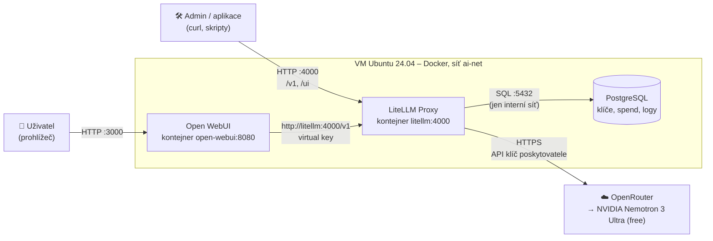

# AI gateway v labu: LiteLLM + Open WebUI v Dockeru

Školicí návod. Na čisté VM s Ubuntu Server 24.04 postavíme vlastní **AI gateway** (LiteLLM) a nad ní webové chatovací rozhraní (Open WebUI). Jazykový model nepoběží lokálně. Použijeme bezplatný model přes službu OpenRouter.

> **Konvence:**
> - Příkazy se spouštějí na serveru jako běžný uživatel se sudo.
> - `<IP_SERVERU>` nahraďte IP adresou své VM. V referenčním labu je to `192.0.2.10`.
> - Hodnoty ve tvaru `<NĚCO>` jsou placeholdery. Skutečná tajemství do návodu ani do gitu nikdy nepatří.

---

## 1. Úvod

### 1.1 Co je LLM

**LLM (Large Language Model)** je jazykový model natrénovaný na obrovském množství textu, který na vstup (*prompt*) generuje textovou odpověď (*completion*). Příklady: GPT (OpenAI), Claude (Anthropic), Gemini (Google), Llama (Meta), Nemotron (NVIDIA).

Aplikace s modelem obvykle komunikují přes **HTTP API**, nejčastěji ve formátu kompatibilním s OpenAI (`POST /v1/chat/completions`). Text se účtuje po **tokenech** (zhruba části slov), zvlášť vstupní a výstupní.

### 1.2 Proč AI gateway

Když ve firmě začne LLM používat víc lidí a aplikací, rychle vznikne chaos: každý má vlastní API klíč, nikdo neví, kolik se utratilo, a výměna poskytovatele znamená úpravu všech aplikací. **AI gateway** je centrální proxy mezi klienty a poskytovateli modelů. Přináší:

| Funkce | Co to znamená v praxi |
|---|---|
| **Centrální správa klíčů** | Klíče k poskytovatelům (OpenAI, Anthropic, OpenRouter…) zná jen gateway. Uživatelé a aplikace dostanou vlastní *virtuální klíče*, které lze kdykoli zneplatnit. |
| **Rate limiting a budgety** | Omezení počtu požadavků či tokenů za minutu a měsíční limit útraty na klíč, uživatele nebo tým. |
| **Logování a audit** | Kdo, kdy, jaký model, kolik tokenů, případně i obsah promptů (pozor na GDPR). |
| **Cost tracking** | Přehled útraty podle klíčů, týmů a modelů. |
| **Přepínání poskytovatelů** | Klienti volají jedno API se stabilním názvem modelu. Za ním lze vyměnit poskytovatele, nastavit fallback nebo load balancing bez zásahu do klientů. |

### 1.3 Co je LiteLLM

[LiteLLM](https://docs.litellm.ai/) je open-source AI gateway (*LiteLLM Proxy Server*). Navenek poskytuje **API kompatibilní s OpenAI** a uvnitř ho překládá na API více než 100 poskytovatelů. S databází PostgreSQL navíc umí virtuální klíče, uživatele, týmy, budgety, spend tracking a webové **Admin UI**.

### 1.4 Co je Open WebUI

[Open WebUI](https://docs.openwebui.com/) je self-hosted webové rozhraní ve stylu ChatGPT. Podporuje uživatele a role, historii konverzací, nahrávání dokumentů (RAG) a další funkce. K modelům se připojuje přes OpenAI-kompatibilní API, v našem případě přes LiteLLM.

### 1.5 Docker a Docker Compose ve zkratce

- **Image** je neměnná šablona aplikace (souborový systém a metadata), například `postgres:16`.
- **Kontejner** je běžící instance image, izolovaný proces s vlastním souborovým systémem a sítí.
- **Volume** je perzistentní úložiště mimo kontejner. Data v něm přežijí smazání i aktualizaci kontejneru.
- **Registry** je úložiště image, například Docker Hub nebo GitHub Container Registry (`ghcr.io`).
- **Docker Compose** popisuje celou aplikaci (víc kontejnerů, sítě, volumes) jedním YAML souborem `docker-compose.yml` a ovládá ji příkazy `docker compose up -d`, `down`, `logs`…

### 1.6 Architektura



Tok požadavku: uživatel napíše dotaz v Open WebUI → Open WebUI ho pošle na LiteLLM a autentizuje se *virtuálním klíčem* → LiteLLM ověří klíč v Postgresu, zavolá OpenRouter se *skutečným* API klíčem a zapíše spotřebu → odpověď se vrátí uživateli.

---

## 2. Prerekvizity

### 2.1 Virtuální stroj

| Položka | Hodnota |
|---|---|
| OS | Ubuntu Server 24.04 LTS (čistá instalace) |
| CPU / RAM / disk | 2 vCPU / 8 GB / 40 GB SSD |
| Přístup | SSH, uživatel s právy `sudo` |
| Síť | přístup na internet (apt repozitáře, `download.docker.com`, `ghcr.io`, Docker Hub, `openrouter.ai`) |

> Model běží v cloudu, takže VM nepotřebuje GPU. Největší nároky má Open WebUI (image kolem 4 GB, za běhu 1–2 GB RAM). Referenční lab běžel i se 4 GB RAM a swapem, ale 8 GB je pohodlnější.

### 2.2 Účet a API klíč na OpenRouter.ai

[OpenRouter](https://openrouter.ai/) je agregátor, který přes jedno API a jeden klíč zpřístupňuje stovky modelů různých poskytovatelů. Část modelů je **zdarma** (v ID mají příponu `:free`). Pro školení je to ideální, protože nikdo nemusí platit.

**Postup:**

1. Otevřete <https://openrouter.ai/> a klikněte na **Sign up** / **Sign in**. Registrovat se lze přes Google, GitHub nebo e-mail. U e-mailu potvrďte ověřovací odkaz.
   [SCREENSHOT: úvodní stránka OpenRouter s tlačítkem Sign in]
2. **Najděte model.** V menu **Models** vyhledejte `Nemotron 3 Ultra` a otevřete variantu **NVIDIA: Nemotron 3 Ultra (free)**. Volné modely najdete i filtrem ceny *Free*. Zkopírujte si **ID modelu**:
   ```
   nvidia/nemotron-3-ultra-550b-a55b:free
   ```
   Přípona `:free` je důležitá. Bez ní se použije placená varianta téhož modelu.
   [SCREENSHOT: stránka modelu NVIDIA: Nemotron 3 Ultra (free) se zvýrazněným ID modelu]
3. **Zkontrolujte nastavení soukromí.** V **Settings → Privacy** (<https://openrouter.ai/settings/privacy>) musíte povolit použití poskytovatelů, kteří u free endpointů mohou prompty logovat nebo je použít k trénování. Jinak OpenRouter vrátí chybu typu *„No endpoints found matching your data policy“*. Důsledek: **do free modelů nepište citlivá ani firemní data.**
   [SCREENSHOT: Settings → Privacy s povolenými free endpointy]
4. **Vytvořte API klíč.** Otevřete **Keys** (<https://openrouter.ai/settings/keys>) → **Create Key**.
   - *Name*: např. `litellm-lab`
   - *Credit limit*: volitelné. U čistě free použití můžete nastavit `0`, aby klíč nemohl nic utratit.
   - Klikněte na **Create** a klíč (začíná `sk-or-v1-…`) si hned zkopírujte. **Zobrazí se jen jednou.** Pokud ho ztratíte, vytvořte nový a starý smažte.
   [SCREENSHOT: dialog Create Key a zobrazený klíč (rozmazaný)]
5. **Limity free modelů** (podle [dokumentace OpenRouter](https://openrouter.ai/docs/api/reference/limits)):
   - 20 požadavků za minutu
   - **50 požadavků za den**, pokud účet nikdy nekoupil kredity
   - 1000 požadavků za den, pokud účet koupil alespoň 10 kreditů (≈ 10 USD)

   Pro školení stačí 50 požadavků denně na studenta. Při zátěžových testech ale počítejte s chybou `429 Too Many Requests`.
6. Klíč si dočasně uložte do správce hesel. Na server ho vložíte v kapitole 6. Nikam jinam ho nepište: ne do chatu, ne do gitu, ne do sdílených dokumentů.

### 2.3 Přehled služeb, portů a adresářů

| Služba | Kontejner | Port na hostu | Port v kontejneru | Účel |
|---|---|---|---|---|
| Open WebUI | `open-webui` | **3000** | 8080 | webové chatovací rozhraní pro uživatele |
| LiteLLM Proxy | `litellm` | **4000** | 4000 | OpenAI-kompatibilní API (`/v1`), Admin UI (`/ui`) |
| PostgreSQL | `postgres` | – (nevystaven) | 5432 | databáze LiteLLM (klíče, spend, logy) |

| Cesta | Obsah |
|---|---|
| `/opt/ai-stack/` | pracovní adresář celého stacku |
| `/opt/ai-stack/docker-compose.yml` | definice služeb |
| `/opt/ai-stack/config.yaml` | konfigurace LiteLLM (modely) |
| `/opt/ai-stack/.env` | **tajemství** (klíče, hesla), práva `600` |
| Docker volume `ai-stack_pgdata` | data PostgreSQL |
| Docker volume `ai-stack_open-webui-data` | data Open WebUI (uživatelé, chaty, nastavení) |

---

## 3. Krok 0: Průzkum výchozího stavu

**Účel:** Než cokoli nainstalujeme, ověříme, že VM odpovídá zadání, má přístup na internet a nekoliduje s ničím, co tam už je (jiný Docker, obsazené porty). Ušetří to hledání chyb později.

### 3.1 Systém a prostředky

```bash
lsb_release -ds; uname -r; nproc; free -h; df -h /
sudo -n true && echo SUDO_OK
timedatectl | head -5
```

**Očekávaný výstup (zkráceně):**
```
Ubuntu 24.04 LTS
6.8.0-xxx-generic
2
Mem:           7.7Gi  ...
/dev/sda2        39G  ...
SUDO_OK
                Time zone: Etc/UTC (UTC, +0000)
```

### 3.2 Kolize: existující Docker / Podman

```bash
dpkg -l | grep -Ei "docker|containerd|runc|podman" || echo none
snap list 2>/dev/null | grep -i docker || echo no-snap-docker
```

**Očekáváno:** `none` a `no-snap-docker`.
Pokud je nainstalovaný `docker.io` z Ubuntu nebo snap `docker`, odstraňte ho před kapitolou 5 (postup je tam uvedený). Dvě instalace Dockeru vedle sebe způsobují nepředvídatelné chyby.

### 3.3 Obsazené porty

```bash
sudo ss -tlnp | grep -E ":(3000|4000|5432)\b" || echo ports-free
```

**Očekáváno:** `ports-free`. Pokud port něco drží, poslední sloupec ukáže proces. Buď ho zastavte, nebo později v compose změňte port na hostu.

### 3.4 Firewall

```bash
sudo ufw status
```

Na čisté instalaci Ubuntu 24.04 bývá výsledek `Status: inactive`.

### 3.5 Přístup na internet

```bash
for u in http://archive.ubuntu.com/ubuntu/ https://download.docker.com/linux/ubuntu/ \
         https://ghcr.io/v2/ https://registry-1.docker.io/v2/ https://openrouter.ai/api/v1/models; do
  printf "%-45s -> " "$u"; curl -s -o /dev/null -m 10 -w "%{http_code}\n" "$u"
done
```

**Očekávaný výstup:**
```
http://archive.ubuntu.com/ubuntu/             -> 200
https://download.docker.com/linux/ubuntu/     -> 200
https://ghcr.io/v2/                           -> 401
https://registry-1.docker.io/v2/              -> 401
https://openrouter.ai/api/v1/models           -> 200
```
`401` u registrů je **v pořádku**. Registry odpovídá a jen požaduje token, který si Docker sám vyžádá.

### Troubleshooting

| Příznak | Příčina / řešení |
|---|---|
| `000` u všech URL | Nefunguje DNS nebo výchozí brána: `resolvectl status`, `ip route`. Ve firemní síti může být nutná HTTP proxy. |
| `000` jen u některých | Blokuje to firewall nebo proxy v síti. Požádejte správce sítě o povolení domén. |
| `sudo: a password is required` | Uživatel nemá sudo bez hesla. Spouštějte `sudo` interaktivně. |

---

*Další kapitoly (příprava systému, Docker, LiteLLM, Open WebUI, provoz, bezpečnost, další kroky) se doplňují průběžně.*
